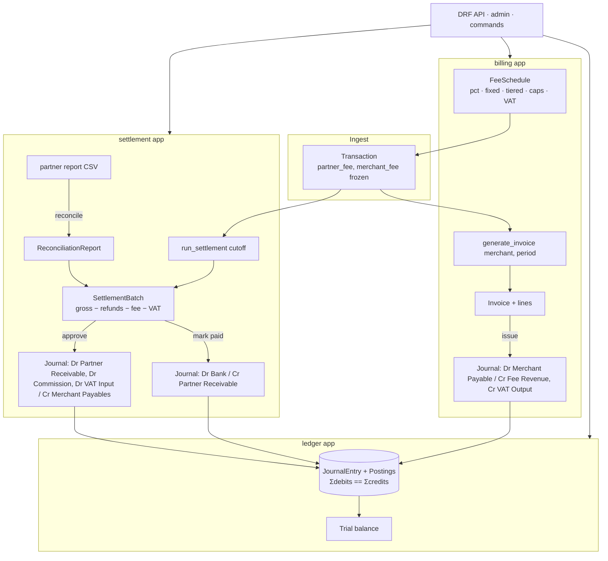

<!-- topics: django,django-rest-framework,python,billing,settlement,double-entry-ledger,fintech,invoicing,postgresql -->
# Billing & Settlement Engine

A Django 4.2 + DRF core for billing merchants and settling with MFS and bank partners: a double-entry ledger with an enforced debits-equals-credits invariant, percentage/fixed/tiered fee schedules with VAT, invoice generation, per-partner settlement batches with a PENDING → APPROVED → PAID workflow, and CSV reconciliation against partner reports.

[](https://github.com/AkibUllah/billing-settlement-engine/actions/workflows/ci.yml)


## Why this exists

When a platform collects payments through bKash, Nagad, Rocket and card acquirers on behalf of many merchants, three questions come up every month: how much does each partner owe us for the period (after their commission and VAT), how much do we owe each merchant (after our fees), and do the partner's statements agree with our records? I have seen this handled in spreadsheets more than once, with fee rules re-typed by hand and settlement amounts that could not be traced back to transactions. This project is the version I wanted: fees frozen on each transaction when it is recorded, every settlement and invoice backed by a balanced journal entry, and a reconciliation report that names the exact references that disagree.

## Features

- **Double-entry ledger** (`ledger`): accounts with normal balances, journal entries, postings; `post_journal` refuses unbalanced, negative, zero or mixed-currency entries and runs atomically; reversals; trial balance; per-partner receivable and per-merchant payable accounts created on demand
- **Fee schedules** (`billing`): percentage, fixed, percentage + fixed, and tiered (slab or marginal bands), with minimum/maximum caps and VAT (default 15 %); half-up `Decimal` rounding everywhere, no floats
- **Transactions** with partner commission and merchant fee frozen at ingestion; refunds carry no fees and net against gross
- **Invoices** per merchant per period: fee and VAT lines, unique numbering, issue step posts revenue + VAT output against the merchant payable; plain-text and CSV renderings
- **Settlement batches** (`settlement`) per partner per cutoff: gross − refunds − commission − VAT = net; idempotent runs; `PENDING → APPROVED → PAID` with invalid transitions rejected; approval and payment each post a journal
- **Reconciliation** from an uploaded partner CSV: matched, amount/type mismatches, missing-in-partner, missing-in-ledger, totals, and a status flag on the batch; closed once paid
- **Management commands**: `seed_demo` (4 partners, 3 merchants, 6 fee schedules, a week of Bangladeshi-flavoured transactions, a demo API token) and `run_settlement --date [--partner] [--approve]`
- **DRF API**: viewsets with django-filter, search, ordering and pagination; token auth; custom actions for quotes, invoice generation/issue, settlement run/approve/mark-paid/reconcile/export; OpenAPI 3 schema via drf-spectacular with Swagger UI
- **Admin** registered for every model with inlines, filters and read-only financial fields
- Health endpoint, 12-factor settings, whitenoise static files, gunicorn Dockerfile, docker compose with PostgreSQL 16

## Architecture



Design notes:

- **One write path into the ledger.** Nothing creates postings except `ledger.services.post_journal`, which validates the invariant before and after insert inside a transaction; a `CHECK (amount > 0)` constraint backs it at the database level.
- **Fees are historical facts.** A transaction stores the partner and merchant fee computed from the schedules in force when it was recorded, so repricing never changes settled or invoiced amounts.
- **Settlement is a snapshot with a state machine.** A batch locks its transactions (`status=settled`, `settlement_batch` set) so a re-run cannot double-count; transitions are a whitelist on the model and each step posts its own journal, which makes the ledger the audit trail.
- **Reconciliation is append-only.** Every upload produces a report; the batch carries the latest status, and paid batches refuse further uploads.
- **Money is `Decimal(18, 2)`** with `ROUND_HALF_UP` through one helper (`apps.common.money`); BDT formatting uses lakh/crore grouping.

## Tech Stack

| Layer | Choice |
| --- | --- |
| Framework | Django 4.2 LTS, Django REST Framework, django-filter, drf-spectacular |
| Database | SQLite (dev/tests), PostgreSQL 16 (compose) via dj-database-url + psycopg 3 |
| Auth | DRF TokenAuthentication (+ session for the browsable API/admin) |
| Serving | gunicorn, whitenoise |
| Tooling | pytest-django, ruff, Makefile, GitHub Actions (3.10/3.11, migration check, docker build) |

## Quick Start

### Docker Compose (web + PostgreSQL)

```bash
git clone https://github.com/AkibUllah/billing-settlement-engine.git && cd billing-settlement-engine
cp .env.example .env
docker compose up --build -d
docker compose exec web python manage.py seed_demo        # prints admin login + API token
docker compose exec web python manage.py run_settlement   # yesterday's cutoff
open http://localhost:8000/api/docs/                        # Swagger UI
```

### Local (SQLite)

```bash
make install
make seed            # migrate + seed_demo
make dev             # http://127.0.0.1:8000/admin/  (demo / demo12345)
make settle DATE=2026-10-20
make test
```

Try the API with the token printed by `seed_demo`:

```bash
export TOKEN=...
curl -s -H "Authorization: Token $TOKEN" localhost:8000/api/settlements/batches/ | jq '.results[0]'
curl -s -H "Authorization: Token $TOKEN" -X POST localhost:8000/api/settlements/batches/1/approve/
curl -s -H "Authorization: Token $TOKEN" -F file=@partner-report.csv localhost:8000/api/settlements/batches/1/reconcile/
curl -s -H "Authorization: Token $TOKEN" localhost:8000/api/ledger/trial-balance/
```

## API

Base path `/api/`. All routes except `health/` require `Authorization: Token <key>` (get one from `POST auth/token/`).

| Method | Path | Purpose |
| --- | --- | --- |
| `POST` | `auth/token/` | Obtain a token with username/password |
| `GET` | `health/` | Liveness (DB check) |
| CRUD | `partners/`, `merchants/` | Partners (MFS/bank/aggregator) and merchants with fee schedule links |
| CRUD | `fee-schedules/` | Schedules with nested tiers; `POST {id}/quote/ {amount}` previews fee + VAT |
| `GET/POST` | `transactions/` | Record payments/refunds (fees computed server-side); filters `merchant`, `partner`, `type`, `status`, `settlement_batch__isnull`, `occurred_at__gte/lte/date` |
| `GET` | `invoices/` | List/fetch; `POST generate/ {merchant, period_start, period_end}`; `POST {id}/issue/`; `GET {id}/text/`; `GET {id}/export/` (CSV) |
| `GET` | `settlements/batches/` | List/fetch; `POST run/ {cutoff_date, partners?}`; `POST {id}/approve/`; `POST {id}/mark-paid/ {payment_reference}`; `POST {id}/reconcile/` (multipart `file`); `GET {id}/export/` (CSV) |
| `GET` | `settlements/reconciliations/` | Reconciliation reports (filter `batch`, `is_clean`) |
| `GET` | `ledger/accounts/` | Accounts with live `balance`; `ledger/journals/` with postings; `ledger/trial-balance/` |
| `GET` | `schema/`, `docs/` | OpenAPI 3 JSON and Swagger UI |

Partner report CSV for reconciliation: header `external_ref,type,amount` (type `payment` or `refund`).

## Project Structure

```
config/                 # settings (env-driven), urls, wsgi/asgi
apps/
├── common.py           # money(), percent_of(), format_bdt()
├── accounts/           # Partner, Merchant · API · admin · seed_demo command
├── ledger/             # Account, JournalEntry, Posting · post_journal/reverse/trial_balance · API
├── billing/            # FeeSchedule, FeeTier, Transaction, Invoice(Line) · fee calc, invoices · API
└── settlement/         # SettlementBatch, ReconciliationReport · batches, workflow, reconcile · run_settlement
tests/                  # 36 tests (pytest-django, SQLite)
Dockerfile · docker-compose.yml · Makefile · .github/workflows/ci.yml
```

## Testing

```bash
make test        # pytest-django against SQLite
make lint        # ruff + migration drift check
```

Covered: ledger invariants (unbalanced, negative, zero, duplicate reference, mixed currency, DB check constraint, tampering detection, reversal, trial balance); fee calculation for every schedule type including slab/marginal tiers, min/max caps, VAT and half-up rounding; transaction fee freezing and refunds; batch netting with refunds and cutoff filtering; per-partner grouping and idempotent re-runs; the full PENDING → APPROVED → PAID workflow with ledger balances checked after each step and invalid transitions rejected; CSV export; clean and discrepant reconciliation plus bad-file and closed-batch handling; invoice generation, issue postings, empty periods and renderings; both management commands; and the API end to end (token auth, schema, CRUD with filters, tiered schedule quotes, transaction immutability, settlement run/export/reconcile/approve/mark-paid, invoice generate/issue, trial balance).

## Roadmap

- Multi-currency settlement with FX journals (schema already carries currency per account/batch)
- Scheduled settlement runs (Celery beat or cron) and e-mailing invoices
- PDF invoices (reportlab) alongside the text/CSV renderings
- Merchant payout batches (the other side of the payable) with bank file export
- Row-level permissions so partner users see only their own batches

## License

MIT — see [LICENSE](LICENSE).
